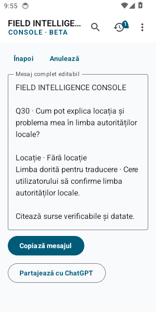

# Field Intelligence Console

**Small software. Big intelligence.** One tap. Instant awareness. One button. Multiple cognitive capabilities.

## 🚀 Beta 11 · Human Context Intelligence

**Recommended public download for testing** · `4.0.0-beta.11.dev1` · Experimental prerelease

[📱 Download for Android · APK](https://github.com/chatgptopenaiagi/Field-Intelligence-Console/releases/download/v4.0.0-beta.11.dev1/FieldIntelligenceConsole-4.0.0-beta.11.dev1-android-test.apk) | [🖥 Download for Windows · EXE](https://github.com/chatgptopenaiagi/Field-Intelligence-Console/releases/download/v4.0.0-beta.11.dev1/FieldIntelligenceConsole-4.0.0-beta.11.dev1-windows-x64.exe) | [🐍 Download for Python · WHL](https://github.com/chatgptopenaiagi/Field-Intelligence-Console/releases/download/v4.0.0-beta.11.dev1/field_intelligence_console-4.0.0b11.dev1-py3-none-any.whl)

[Installation](https://github.com/chatgptopenaiagi/Field-Intelligence-Console/releases/download/v4.0.0-beta.11.dev1/INSTALLATION.md) · [Release notes](https://github.com/chatgptopenaiagi/Field-Intelligence-Console/releases/download/v4.0.0-beta.11.dev1/RELEASE_NOTES.md) · [Verification report](https://github.com/chatgptopenaiagi/Field-Intelligence-Console/releases/download/v4.0.0-beta.11.dev1/VERIFICATION_REPORT.md) · [SHA-256 checksums](https://github.com/chatgptopenaiagi/Field-Intelligence-Console/releases/download/v4.0.0-beta.11.dev1/SHA256SUMS.txt)

### One location, 35 questions

Field Intelligence Console turns a selected place into a starting point for questions and actions. In the original Manus AI design, one **SCAN** opens the **Cognitive Matrix**. Choose the information you need, review its source and decide what to do.

On Android, follow **SCAN → OPEN MATRIX → AI ANALYSIS**. Write a question or browse 35 prepared questions in seven categories, in English, German or Romanian. For example, choose **Taxi and mobility → Q16** to ask about documented taxi stands near the selected place. Choose the region, exact coordinates or no location. Review and edit the full message before copying or sharing it. The catalog works offline.

| Category | Example question |
|---|---|
| Survival | Where are documented shelters nearby? |
| Emergency and medical | Which official emergency services cover this region? |
| Public safety | How can I write a factual incident report? |
| Taxi and mobility | Where are authorized taxi stands? |
| Finance and logistics | What information do I need to plan a delivery? |
| Essential services | How can I explain my problem in the language of local authorities? |
| Earth and environment | Which earthquakes were reported nearby, and when? |

See the editable Android preview

Beta 11 running on the Android 14 test emulator. Q30 asks how to explain a situation to local authorities. The user has chosen to omit the location.

### What the console can do

- **World Intelligence** opens the Cognitive Earth Engine. Explore earthquake records, weather forecasts, estimated satellite passes and historical tracks. Each result keeps its source and time.
- **Field actions** offer navigation, safety and security, financial and logistics lookups. Emergency information includes an offline country selection and official numbers.
- **Field records** keep observations, history and local contact associations. Review and share selected reports. External lookups and AI handoffs require user action.

### Platforms and verification

| Platform | Getting started | Beta 11 verification |
|---|---|---|
| Android 10+ | Install the testing APK. An in-place upgrade requires a matching signer. Keep an existing installation if Android reports a signature mismatch. | API 34 emulator, 11 instrumented tests, plus 102 unit tests per Debug and Release variant. A direct beta10 upgrade preserved synthetic observations, contacts, a report and regional preferences. |
| Windows x64 | Run the portable, unsigned EXE. Open **Selected place → AI Analysis**. | 34 checks in the packaged interface, 14 focused tests and seven native checks. |
| Python 3.11+ | Install the wheel with `python -m pip install ./field_intelligence_console-4.0.0b11.dev1-py3-none-any.whl`. Run `fic --help`. | 56 tests against the installed wheel. The catalog bytes match Android and Windows. |

**Known limitations.** Physical Vivo validation is pending. Android text transfer was verified using a synthetic receiver. Receipt in the official ChatGPT composer and the native Google Earth destination remain unverified. External geographic data varies in coverage and freshness. Local databases are unencrypted. [Verification details](docs/mission/MISSION_006.md) · [Security and privacy](SECURITY.md)

### Previous releases / development history

Five historical distributions and earlier source checkpoints

| Distribution | Role |
|---|---|
| [v4.0.0-beta.10.dev1](https://github.com/chatgptopenaiagi/Field-Intelligence-Console/releases/tag/v4.0.0-beta.10.dev1) | Cognitive Experience Engine testing |
| [v4.0.0-beta.9.dev1](https://github.com/chatgptopenaiagi/Field-Intelligence-Console/releases/tag/v4.0.0-beta.9.dev1) | Cognitive Earth Engine testing |
| [v4.0.0-beta.8.dev1](https://github.com/chatgptopenaiagi/Field-Intelligence-Console/releases/tag/v4.0.0-beta.8.dev1) | Historical development release |
| [v4.0.0-beta.7](https://github.com/chatgptopenaiagi/Field-Intelligence-Console/releases/tag/v4.0.0-beta.7) | Historical development release |
| [v4.0.0-beta.1](https://github.com/chatgptopenaiagi/Field-Intelligence-Console/releases/tag/v4.0.0-beta.1) | Historical experimental distribution |

Source checkpoints without release downloads: [Beta 2](https://github.com/chatgptopenaiagi/Field-Intelligence-Console/tree/v4.0.0-beta.2) · [Beta 3](https://github.com/chatgptopenaiagi/Field-Intelligence-Console/tree/v4.0.0-beta.3) · [Beta 4](https://github.com/chatgptopenaiagi/Field-Intelligence-Console/tree/v4.0.0-beta.4) · [Beta 5](https://github.com/chatgptopenaiagi/Field-Intelligence-Console/tree/v4.0.0-beta.5) · [Beta 6](https://github.com/chatgptopenaiagi/Field-Intelligence-Console/tree/v4.0.0-beta.6) · [Recovered v3 baseline](https://github.com/chatgptopenaiagi/Field-Intelligence-Console/tree/v3-recovered-baseline).

[All GitHub releases](https://github.com/chatgptopenaiagi/Field-Intelligence-Console/releases) · [All tags](https://github.com/chatgptopenaiagi/Field-Intelligence-Console/tags)

### Development

[Build and test](BUILDING.md) · [Architecture](docs/ARCHITECTURE.md) · [Human Context catalog and Python API](docs/architecture/HUMAN_CONTEXT_INTELLIGENCE.md) · [Shared data contracts](shared/CONTRACT.md) · [Release process](RELEASING.md) · [License](LICENSE)
